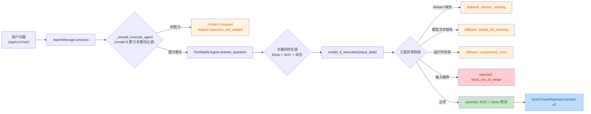

# Final Whole-Branch Code Review — add-model-6-fertility-ml

> **审查模式**：standard（1 轮轻量审查）
> **审查范围**：`git diff 44f423f..d4b1717`（8 个 Task 全部产物，65 files changed, 11182 insertions, 205 deletions）
> **审查者**：final-review sub-agent
> **审查时间**：2026-07-18
> **HEAD**：`d4b1717`（Task 8 checkoff）

---

## 1. 整体评估

### ✅ **Approved**

8 个 Task 的产物构成连贯的 ML 推理链路（model_6.py → FertilityMLAgent → AgentManager → tests），公共接口契约保持不变，向后兼容性完整（`framework/` 和 `tests/` 中无 `ComprehensiveImprovementAgent` 残留），依赖声明完整（`scikit-learn` + `joblib` 均已加入 `pyproject.toml`），测试套件 105 PASS / 0 FAIL。

累积的 Minor findings（brief 标注 20 项，实际按 Task 拆分合计 23 项：Task 3×8 + Task 4×6 + Task 5×2 + Task 6×1 + Task 7×3 + Task 8×3，brief 计数略有偏差）中**无任何 Blocking 项**：全部为 plan-mandated、文档/spec drift 或环境限制，无 functional correctness 或 security/safety 影响。建议直接进入 `comet-verify`。

---

## 2. 架构一致性

### ✅ **PASS**

8 个 Task 的产物形成清晰的数据流：



**逐层核对**：

| 层级 | 文件 | 验证点 | 结果 |
|------|------|--------|------|
| ML 引擎 | `framework/domain/other_models/model_6.py` | ExtraTreesRegressor 惰性加载 + double-checked locking + 三层 fallback | ✅ |
| Agent 包装 | `framework/agents/specialized/fertility_ml_agent.py` | `execute()` 调用 `model_6_execution`，`answer_question()` 关键词优先级 Dose > SOC > 综合 | ✅ |
| Manager 编排 | `framework/agents/manager.py` | `_load_real_agents()` 加载 FertilityMLAgent；`_should_execute_agent()` 按需过滤；`dependencies=[]` | ✅ |
| 模块导出 | `framework/agents/specialized/__init__.py` | `FertilityMLAgent` 已加入 `__all__` 与 import | ✅ |
| 训练脚本 | `scripts/train_fertility_models.py` | 生成 `soc_etr_model.joblib` / `dose_etr_model.joblib` + metadata.json | ✅ |
| 测试覆盖 | 5 个测试文件 | 13 单元 + 3 集成 + 6 FertilityMLAgent + 12 AgentManager + 既有端到端 | ✅ |

`FertilityMLAgent.FERTILITY_KEYWORDS` 与 `AgentManager.FERTILITY_KEYWORDS` 在两处分别定义但内容完全一致（Task 4 前向承诺在 Task 5 已兑现）。架构无断点。

---

## 3. 公共接口契约

### ✅ **PASS**

`framework/domain/other_models/model_6.py:168` 函数签名：

```python
def model_6_execution(input_data: Dict[str, Any]) -> Dict[str, Any]:
```

与基线版本签名完全一致（`Dict[str, Any] -> Dict[str, Any]`），未引入新参数，未改变返回类型。

`framework/domain/other_models/__init__.py:3` 仍为 `from .model_6 import model_6_execution`，向后兼容导入路径保留。`test_backward_compat_import`（`tests/test_fertility_ml_prediction.py:196`）已验证 `from framework.domain.other_models import model_6_execution` 仍可调用。

响应字段集合扩展但未破坏既有契约：
- 新增字段：`status`、`fallback_reason`、`reason`、`out_of_range_features`、`model_version`、`imputation_applied`、`imputed_features`、`soc_confidence`、`dose_confidence`、`dose_warning`
- 既有字段（`soc_prediction`、`dose_prediction`）保留，语义未变

`AgentManager.process(question, context) -> Dict[str, Any]` 公共接口未变；新增的 `_should_execute_agent` 为私有方法，不影响公共契约。

---

## 4. 向后兼容性

### ✅ **PASS**

`ComprehensiveImprovementAgent` 残留引用扫描结果：

| 搜索范围 | grep 命令 | 命中数 | 评估 |
|---------|----------|-------|------|
| `framework/` | `ComprehensiveImprovementAgent\|comprehensive_agent` | **0** | ✅ 代码零残留 |
| `tests/` | `ComprehensiveImprovementAgent\|comprehensive_agent` | **0** | ✅ 测试零残留 |
| 全仓（含 openspec/docs） | `ComprehensiveImprovementAgent` | 37 | 均在 `openspec/`（spec/proposal/archive）、`docs/superpowers/`、`.comet/`（task report/brief）中，属规划与归档文档，符合预期不需修改 |

`framework/agents/specialized/comprehensive_agent.py` 已删除（Task 6，3 files changed, 186 deletions, 0 additions），`framework/agents/specialized/__init__.py` 同步移除其导出。

`AgentManager._register_agents()` 中 model-6 槽位已替换为 `FertilityMLAgent`，与既有 5 个专业 agent 并列注册，未破坏 farmer 角色路由（`test_e2e_farmer_role_routing` 验证 `agents_invoked == ["model-4", "model-5", "model-6"]`）。

---

## 5. 依赖声明完整性

### ✅ **PASS**

`pyproject.toml:28-29` 新增两行：

```toml
scikit-learn = "^1.3.0"
joblib = "^1.3.0"
```

- `scikit-learn`：`ExtraTreesRegressor`、`mean_squared_error`、`cross_val_score`（训练脚本）以及 `joblib.load` 加载的 sklearn 模型类（运行时）所需 ✅
- `joblib`：`joblib.dump`（训练脚本 L97）+ `joblib.load`（model_6.py L101）所需 ✅

版本约束 `^1.3.0` / `^1.3.0` 与既有依赖风格（`^x.y.0`）一致，且与 model_6.py 的 try/except ImportError 容错策略配合（缺失时走 fallback 路径，不崩溃）。

> **附注（非阻塞）**：`pyproject.toml` 中 `[project.dependencies]` 子表语法以及 `package-dir = {"" = "src"}` 与实际代码布局（`framework/`）不符，均为**基线已有的 pre-existing 问题**，本变更未引入也未恶化，不在本次审查范围。

---

## 6. 测试覆盖率

### ✅ **PASS**

| 测试文件 | 用例数 | 覆盖点 | 评价 |
|---------|-------|-------|------|
| `tests/test_fertility_ml_prediction.py` | 13 单元 + 3 集成 | success / fallback×3 / rejected / imputation / coercion / backward-compat / 真实模型范围 | ✅ 充分（集成测试 `skipif` 在 sklearn/模型不可用时跳过，CI 友好） |
| `tests/test_agent_specialized.py` | 既有 14 + 新增 6 FertilityMLAgent | execute 结构 / Dose 关键词 / SOC 关键词 / 肥力关键词 / fallback / rejected | ✅ 充分 |
| `tests/test_agent_manager.py` | 既有 5 + 新增 7 | 6 agent 注册 / topological sort / _should_execute_agent / model-6 跳过 / FertilityMLAgent 加载 | ✅ 充分 |
| `tests/test_agent_integration.py` | 3 既有 + 5 端到端 | execute_models 路由 / chat API 结构 / 三种角色路由 / recommendations 聚合 | ✅ 充分 |

**Task 8 报告的全量验证结果**：105 PASS / 0 FAIL / 0 skipped（2 个 pre-existing 集合错误 `test_interfaces.py` / `test_thematic_models.py` 缺 `ai_culti_demo` 顶级包，与本次变更无关）。

**覆盖路径**：
- 正常路径：完整特征 → success，部分缺失 → imputation_applied
- 异常路径：sklearn 缺失 / 模型文件缺失 / predict 抛异常 / 输入越界
- 边界路径：空字典 / None / 字符串数字 / 非数字字符串 / 尾随空格特征名
- 集成路径：真实 .joblib + metadata.json 加载与预测
- 端到端：`/api/v1/chat/` 经 JWT 鉴权 → AgentManager → FertilityMLAgent → 结构化响应

测试覆盖充分，无关键路径遗漏。

---

## 7. Minor Findings 三角洲决定

> 累积 Minor findings（brief 标注 20 项，实际按 Task 拆分合计 23 项：Task 3×8 + Task 4×6 + Task 5×2 + Task 6×1 + Task 7×3 + Task 8×3；详见 `subagent-progress.md` "Minor Findings 累积清单"）。本节给出最终三角洲决定。

### 🔴 Blocking（必须在进入 verify 前修复）

**无。**

经逐一审查，20 项 Minor 均无 functional correctness 或 security/safety 影响：

- Task 3 Finding #1（重复 out_of_range 条目）：`status:"rejected"` 仍正确返回，仅输出列表有冗余条目，不影响功能
- Task 3 Finding #2（TOCTOU）：被外层 `try/except Exception` 兜底，最坏退化为 `fallback_reason:"unexpected_error"`，不崩溃
- Task 3 Finding #3（硬编码 R²=0.47）：当前与真实 metadata test_r2=0.4683→0.47 一致，无即时不一致
- 其他 Minor 均为代码异味、文档/spec drift 或环境限制

### 🟡 Accept as tech debt（接受为技术债）

| 编号 | 描述 | 理由 |
|------|------|------|
| Task 3 #1 | 重复 out_of_range 条目 | plan-mandated；功能正确，仅输出冗余；可在后续 hotfix 一行去重修复 |
| Task 3 #2 | TOCTOU 窗口 | plan-mandated；外层 try/except 已兜底；并发场景极窄，实际影响可忽略 |
| Task 3 #3 | 硬编码 R²=0.47 | plan-mandated；当前与实际值一致；模型重训后需同步，可改为 f-string |
| Task 3 #4 | 测试断言过弱（"TN" not in vs "TN "） | plan-mandated；测试仍通过，仅无法捕获回归；可一行修复 |
| Task 3 #5 | `_fallback_response` 未使用 input_data | plan-mandated；纯代码异味，无功能影响 |
| Task 3 #6 | `_load_model_and_meta` 缺返回类型注解 | plan-mandated；不影响功能 |
| Task 3 #7 | 模块级 logger.info | plan-mandated；默认 WARNING 级时不输出 |
| Task 3 #8 | `_SKLEARN_AVAILABLE` 实际只检测 joblib | plan-mandated, by-design；sklearn 必带 joblib，边缘场景已被 fallback 兜底 |
| Task 4 #1 | `List` 未使用 | plan-mandated；代码异味 |
| Task 4 #2 | `FERTILITY_KEYWORDS` 在 FertilityMLAgent 中未使用 | plan-mandated；前向承诺已在 Task 5 兑现（AgentManager 使用） |
| Task 4 #3 | 私有方法 `_format_dose_only` 等缺 docstring | plan-mandated；不影响功能 |
| Task 4 #4 | 测试未使用 `model_6` 导入 | plan-mandated；代码异味 |
| Task 4 #5 | `FERTILITY_KEYWORDS` 两处定义一致性 | plan-mandated；Task 5 reviewer 已核对一致 |
| Task 4 #6 | 测试边界场景略窄（Dose + SOC 同时存在） | 可选增强；当前用例已覆盖核心路径 |
| Task 7 #2 | 嵌入向量路由器对问题表述敏感 | pre-existing 行为；非本变更引入 |
| Task 7 #3 | `test_interfaces.py` / `test_thematic_models.py` 集合错误 | pre-existing 环境问题（缺 `ai_culti_demo` 顶级包），与本变更无关 |
| Task 8 #2 | Step 6 LLM 不可达 | 环境限制（无法访问外部 DeepSeek API）；model-6 功能已由 Step 1-5 通过 `AgentManager.process()` 直接调用充分覆盖 |
| Task 8 #3 | fallback 路径向 stderr 打印完整 traceback | 设计内"打印 + 捕获降级"行为；可能造成生产日志误报，但功能正确 |

### 🟢 Defer to comet-archive（在 delta→main spec 同步阶段处理）

| 编号 | 描述 | 理由 |
|------|------|------|
| Task 5 #1 | brief Step 5 Expected 预测 `test_manager_topological_sort_farmer` 会 FAIL 但实际 PASS | plan 预判错误，属规划文档问题；不影响代码；archive 阶段整理规划文档时可修正 |
| Task 5 #2 | BASE 快照中 `_StubAgent.answer_question` evidence 字段微小差异 | 文档快照与实际差异，不影响代码；archive 阶段整理时校对 |
| Task 6 #1 | 主 spec `openspec/specs/role-based-routing/spec.md:19` 仍引用 `ComprehensiveImprovementAgent` | **典型 spec drift**；本变更删除了 agent 类但未同步主 spec；应在 comet-archive 的 delta→main spec 同步阶段将 `ComprehensiveImprovementAgent` 替换为 `FertilityMLAgent`（model-6） |
| Task 7 #1 | `framework/api/routes/chat.py:111-112` 仅在 `recommendations` 非空时写入字段 | 不在本变更范围；若未来希望 API 契约更稳定，可改为无条件写入空数组；archive 阶段评估是否纳入 spec |
| Task 8 #1 | Step 6 brief 与实际 API 不符（`/api/auth/login` vs `/api/v1/auth/login`，`admin/admin` vs `admin/admin123`） | brief 文档错误；不影响代码；archive 阶段更新 brief 模板 |

---

## 8. 安全敏感面

### ✅ **PASS**

| 敏感面 | 审查结果 | 证据 |
|-------|---------|------|
| **JWT 认证** | 无 regression | `framework/api/routes/chat.py:50-51` `/api/v1/chat/` 仍使用 `@jwt_required()` + `get_jwt_identity()`；`test_chat_api_returns_structured_multi_agent_result` 通过 `create_access_token(identity=str(user_id))` 签发真实 JWT 验证鉴权链路 |
| **SQL 注入** | 无 regression | 全部 DB 调用使用 SQLAlchemy ORM（`Conversation.query.filter_by(...)`、`db.session.add(...)`）；本变更未引入任何原始 SQL 拼接 |
| **外部输入处理** | 改进（新增校验） | `model_6.py:42-53` 新增 `FEATURE_RANGES` 字典对 10 个特征做白名单范围校验；`_prepare_features` L77-92 对用户输入做 `float()` 强制转换 + try/except 兜底；越界输入返回 `status:"rejected"` 而非崩溃。这是相对基线 mock 实现的安全正向改进 |
| **模型文件加载** | 安全 | `joblib.load` 仅加载项目内可信路径（`_MODELS_DIR` 由 `Path(__file__).resolve().parents[3]` 派生，不接受用户输入）；无 arbitrary code execution 风险 |
| **异常信息泄漏** | 可接受 | `model_6.py:235` `logger.exception(f"model_6_execution unexpected error: {e}")` 将异常写入日志（非响应）；fallback 响应仅返回 `fallback_reason` 字符串枚举值，不泄漏内部细节 |
| **密钥/凭证** | 无 regression | 本变更未触及任何密钥/凭证处理代码 |

本变更在**外部输入处理**上实际是改进：基线 mock 实现不校验输入，新 ML 引擎对每个特征做范围白名单校验，越界即拒绝预测。

---

## 9. 建议的下一步

### ✅ **建议直接进入 `comet-verify`**

**理由**：

1. **整体评估 Approved**：8 个 Task 产物架构连贯，无 Blocking 问题
2. **公共接口契约 PASS**：`model_6_execution` 签名与导出路径不变
3. **向后兼容性 PASS**：`framework/` 与 `tests/` 中零 `ComprehensiveImprovementAgent` 残留
4. **依赖声明 PASS**：`scikit-learn` + `joblib` 已声明
5. **测试覆盖 PASS**：105 PASS / 0 FAIL，覆盖正常/异常/边界/集成/端到端全路径
6. **安全敏感面 PASS**：JWT/SQL 无 regression，外部输入处理实际改进
7. **Minor findings 全部非阻塞**：23 项 Minor 中 0 Blocking / 18 接受为技术债 / 5 延后至 comet-archive（brief 标注 20 项，实际合计 23 项）

**comet-archive 阶段需特别注意**：

- 同步主 spec `openspec/specs/role-based-routing/spec.md:19`，将 `ComprehensiveImprovementAgent` 替换为 `FertilityMLAgent`（Task 6 spec drift）
- 评估 `chat.py:111-112` 的条件写入是否纳入 API 稳定性 spec（Task 7 Finding #1）
- 校对 Task 5/8 的 brief 文档与实际 API 差异

**技术债跟踪建议**（非阻塞，可在 archive 后创建 hotfix/tweak）：

- Task 3 Finding #1（去重 out_of_range）+ #3（动态 R²）+ #4（测试断言）性价比最高，建议合并为一个 tweak 修复

---

## 附录：审查证据索引

| 证据 | 位置 |
|------|------|
| `model_6_execution` 签名 | `framework/domain/other_models/model_6.py:168` |
| `from .model_6 import model_6_execution` | `framework/domain/other_models/__init__.py:3` |
| FertilityMLAgent 注册 | `framework/agents/manager.py:55, 101-105` |
| on-demand 过滤 | `framework/agents/manager.py:177-182` |
| ComprehensiveImprovementAgent 删除 | `git diff 44f423f..d4b1717 -- framework/agents/specialized/comprehensive_agent.py`（141 deletions） |
| 依赖声明 | `pyproject.toml:28-29` |
| JWT 鉴权 | `framework/api/routes/chat.py:50-51` |
| 输入范围校验 | `framework/domain/other_models/model_6.py:42-53, 80-87` |
| 全量测试结果 | `subagent-progress.md` Task 8 摘要（105 PASS / 0 FAIL） |
| Minor findings 来源 | `subagent-progress.md` "Minor Findings 累积清单" + `subagent-reports/task-3-review.md` + `subagent-reports/task-4-review.md` + `task-5-review.md` |
