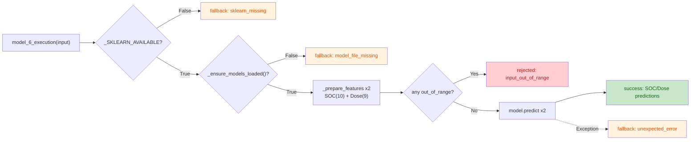

# Task 3 Review — model_6.py 真实 ML 实现

> **Reviewer 报告**：基于 `task-3-brief.md`（规格）、`task-3-report.md`（implementer 自报）、`task-3-review-package.diff`（diff with 10 lines context）审查 Task 3 实现。
> **审查范围**：`framework/domain/other_models/model_6.py`（重写，+232/-6）、`tests/test_fertility_ml_prediction.py`（新建，+242）
> **审查方式**：基于 diff + 实际磁盘文件 + 真实 metadata.json 验证，未重跑 implementer 已通过的测试
> **BASE commit**：`b15ec3f` → **HEAD**：`4cc5f4f`

## 审查方法学

1. 逐项核对 brief 中 19 条 Global Constraints 检查清单
2. 比对实际磁盘文件（`model_6.py`、`__init__.py`、测试文件）与 brief 提供代码
3. 读取真实 `data/fertility/models/*.json` 验证 R² 值与特征列表
4. 静态分析并发安全性、异常处理、测试独立性
5. 所有发现标注严重级别与是否 `plan-mandated`

---

## 📊 变更概览



**三层异常防线**：sklearn_missing（import 层）→ model_file_missing（加载层）→ unexpected_error（运行时层），每层都有 fallback 响应，符合 spec。

---

## 1. Spec Compliance Verdict

- **Status**: ✅ **PASS**

### 检查清单逐项核对

| # | 检查项 | 结果 | 证据（model_6.py 行号） |
|---|--------|------|-------------------------|
| 1 | `_MODEL_VERSION = "ETR_v1_20260713"` 硬编码常量 | ✅ | L39 |
| 2 | 模型路径用 `Path(__file__).resolve().parents[3] / "data" / "fertility" / "models"` | ✅ | L15 |
| 3 | `_SKLEARN_AVAILABLE` 在 try/except 中设置（import joblib 失败为 False） | ✅ | L22-26 |
| 4 | `_SOC_LOAD_FAILED`/`_DOSE_LOAD_FAILED` 加载失败后设 True 且不重试 | ✅ | L128, L144（设 True）；L112-113（入口早返回） |
| 5 | double-checked locking + `threading.Lock`（先检查→加锁→再检查） | ✅ | L115-117, L131-133 |
| 6 | `FEATURE_RANGES` 含全部 10 特征且范围匹配 brief | ✅ | L42-53（pH 3-11、SOCbe 0-100、TN 0-10、TP 0-10、TK 0-100、AP 0-200、AK 0-500、Gap -10~50、Dose 0-1000、Fertilizer type 1-2） |
| 7 | `_prepare_features` 做 `strip()` 规范化（兼容 "TN "/"TN"） | ✅ | L68（input key strip）、L75（feature name strip） |
| 8 | 缺失/转换失败字段用 `feature_means` 填充 + 加入 `imputed_list` | ✅ | L93-94 |
| 9 | 越界字段加入 `out_of_range_list` 并用均值填充 | ✅ | L81-87 |
| 10 | 任一越界 → `status:"rejected"` + `reason:"input_out_of_range"` + `out_of_range_features` | ✅ | L198-211 |
| 11 | 任一模型文件缺失 → `status:"fallback"` + `fallback_reason:"model_file_missing"` | ✅ | L180-181 |
| 12 | sklearn 不可用 → `status:"fallback"` + `fallback_reason:"sklearn_missing"` | ✅ | L176-177 |
| 13 | fallback confidence=0.3 + 训练集均值 | ✅ | L156-159（META 可用时取 feature_means，否则硬编码 12.0/100.0） |
| 14 | success SOC confidence=round(test_r2,2)=0.91，Dose=0.47 | ✅ | L225, L227；真实 metadata SOC test_r2=0.9096→0.91，Dose test_r2=0.4683→0.47 |
| 15 | success `dose_warning` 含"仅供参考" | ✅ | L228（"Dose 模型 R²=0.47，预测结果仅供参考，建议结合田间试验校准"） |
| 16 | `imputed_features = sorted(set(soc_imputed + dose_imputed))` | ✅ | L229 |
| 17 | Dose 特征去掉 Dose 自身（9 因子） | ✅ | L189-194（dose_input 过滤 Dose）+ 真实 Dose metadata feature_names 含 9 项 |
| 18 | 异常捕获 → `fallback_reason:"unexpected_error"` | ✅ | L234-236 |
| 19 | `from .model_6 import model_6_execution` 向后兼容（`__init__.py` 未改） | ✅ | `__init__.py` L3 未变；model_6.py L168 导出函数 |

**所有 19 项 Spec Compliance 检查全部通过。**

---

## 2. Code Quality Verdict

- **Status**: ⚠️ **Approved with concerns**

所有发现的问题均源于 brief/plan 提供的代码（`plan-mandated`），implementer 逐字采用 brief 代码符合 Task 3 契约。以下问题需主会话决定是否升级到用户决策或在未来 Task 修复。

### Findings

#### Finding 1 — `out_of_range_features` 可能包含重复条目 [Minor, plan-mandated]

**位置**：`model_6.py` L197 `all_oor = soc_oor + dose_oor`

**问题**：SOC 与 Dose 的 `feature_names` 共享 9 个特征（pH、SOCbe、TN、TP、TK、AP、AK、Gap、Fertilizer type，已通过真实 metadata 验证）。当任一共享特征越界时，`_prepare_features` 会被调用两次（一次为 SOC、一次为 Dose），同一越界特征会被加入 `soc_oor` 和 `dose_oor` 两个列表。`all_oor = soc_oor + dose_oor` 直接拼接，不去重。

**影响**：用户收到 `out_of_range_features: [{"feature":"pH",...}, {"feature":"pH",...}]` 这种重复条目。功能不受影响（`status:"rejected"` 仍正确），但响应输出冗余、不优雅。

**测试未捕获**：`test_rejected_out_of_range_ph` 与 `test_rejected_fertilizer_type_invalid` 都用 `"pH" in oor_features` / `"Fertilizer type" in oor_features` 检查，`in` 操作符对重复元素也返回 True，所以测试通过但无法发现重复。

**建议修复**（可选）：
```python
# 去重：按 feature 名保留首个 occurrence
seen = set()
deduped_oor = []
for item in all_oor:
    if item["feature"] not in seen:
        seen.add(item["feature"])
        deduped_oor.append(item)
all_oor = deduped_oor
```

#### Finding 2 — Double-checked locking 存在窄窗口 TOCTOU [Minor, plan-mandated]

**位置**：`model_6.py` L119 `_SOC_MODEL, _SOC_META = _load_model_and_meta(...)`（L135 同理）

**问题**：Python 元组解包 `_SOC_MODEL, _SOC_META = expr` 不是原子的：先赋值 `_SOC_MODEL`，再赋值 `_SOC_META`，两个 `STORE_ATTR` 字节码之间存在线程切换窗口。理论上：

- Thread A：在锁内赋值 `_SOC_MODEL = model` 后、赋值 `_SOC_META = meta` 前被切换
- Thread B：检查 `_SOC_MODEL is None` → False（A 刚赋值），跳过锁，使用 `_SOC_META` → 仍为 None → `_SOC_META["feature_names"]` 抛 `TypeError`

**影响评估**：
- 概率极低：仅在首次加载的几个字节码窗口内
- 后果可控：外层 `try/except Exception` 捕获后返回 `fallback_reason:"unexpected_error"`，不会崩溃
- 仅发生一次：加载成功后两个变量都非 None，后续读取无风险

**GIL 不阻止此问题**：GIL 只保证字节码原子性，不保证两个 `STORE_ATTR` 之间无切换。

**建议修复**（可选）：使用单一状态对象原子赋值
```python
_SOC_STATE = {"model": model, "meta": meta}  # 单次 STORE_ATTR，原子可见
```
但这超出 brief 范围，且当前实现已被外层 try/except 兜底，实际影响可忽略。

#### Finding 3 — `dose_warning` 硬编码 "R²=0.47" 可能与重训后实际值不一致 [Minor, plan-mandated]

**位置**：`model_6.py` L228 `"dose_warning": "Dose 模型 R²=0.47，预测结果仅供参考..."`

**问题**：`dose_confidence` 用 `round(_DOSE_META["metrics"]["test_r2"], 2)` 动态读取（当前=0.47），但 `dose_warning` 字符串中的 "0.47" 是硬编码。若模型重训后 test_r2 变化（如 0.52），`dose_confidence` 会更新为 0.52，但 warning 仍显示 0.47，造成字段间不一致。

**当前状态**：真实 Dose metadata test_r2=0.4683→0.47，与硬编码值一致，无即时问题。

**建议修复**（可选）：
```python
"dose_warning": f"Dose 模型 R²={round(_DOSE_META['metrics']['test_r2'], 2)}，预测结果仅供参考，建议结合田间试验校准",
```

#### Finding 4 — `test_feature_name_with_trailing_space` 断言过弱 [Minor, plan-mandated]

**位置**：`tests/test_fertility_ml_prediction.py` L181 `assert "TN" not in result["imputed_features"]`

**问题**：`imputed_features` 中的元素是原始 `fname`（含尾随空格，如 `"TN "`），而断言检查 `"TN"`（无空格）。由于 `"TN" != "TN "`，即使 TN 匹配失败被填充（`imputed_features` 含 `"TN "`），断言 `"TN" not in [...]` 仍为 True，测试仍通过。

**影响**：测试无法捕获 "TN 匹配失败" 的回归。测试名称声称验证 "用户传 'TN'，模型 feature_names 含 'TN ' → 正确匹配"，但实际断言不能区分匹配成功与失败。

**建议修复**（可选）：
```python
# 应检查 "TN "（含空格）或用 strip 比较
assert not any(f.strip() == "TN" for f in result["imputed_features"])
# 或
assert "TN " not in result["imputed_features"]
```

#### Finding 5 — `_fallback_response` 的 `input_data` 参数未使用 [Minor, plan-mandated]

**位置**：`model_6.py` L152 `def _fallback_response(input_data: Dict[str, Any], reason: str)`

**问题**：函数体内未引用 `input_data`。`dose_warning` 仅依赖 `reason`，`soc_prediction`/`dose_prediction` 仅依赖 `_SOC_META`/`_DOSE_META`。参数纯冗余。

**影响**：无功能影响，仅代码异味。调用方（L177, L181, L236）都传入 `input_data or {}`，可读性略受影响。

**建议修复**（可选）：移除参数，或在 docstring 说明保留用于未来扩展。但不建议在 Task 3 改动（超出 brief 范围）。

#### Finding 6 — `_load_model_and_meta` 缺少返回类型注解 [Minor, plan-mandated]

**位置**：`model_6.py` L99 `def _load_model_and_meta(model_path: Path, meta_path: Path):`

**问题**：其他函数（`_prepare_features`、`_ensure_models_loaded`、`_fallback_response`、`model_6_execution`）都有完整类型注解，唯独此函数缺返回类型。

**建议修复**（可选）：
```python
def _load_model_and_meta(model_path: Path, meta_path: Path) -> Tuple[Any, Dict[str, Any]]:
```

#### Finding 7 — 模块导入时 `logger.info` 可能在日志未配置时输出 [Minor, plan-mandated]

**位置**：`model_6.py` L28 `logger.info("model_6 module imported, sklearn_available=%s", _SKLEARN_AVAILABLE)`

**问题**：模块级 `logger.info` 在 `import framework.domain.other_models` 时触发。若上游未配置 logging，Python 默认会丢弃 INFO 级日志（默认 effective level WARNING），所以实际不会输出。但若上游配置了 INFO 级日志，会在每次进程首次 import 时输出一行。

**影响**：可忽略。Python 模块缓存保证每个进程只 import 一次，不会重复输出。

#### Finding 8 — `_SKLEARN_AVAILABLE` 实际只检测 joblib [Minor, plan-mandated, by-design]

**位置**：`model_6.py` L22-26 `try: import joblib ...`

**问题**：变量名暗示检测 sklearn，实际只检测 joblib import。理论上存在 joblib 可用但 sklearn 不可用的边缘场景：此时 `_SKLEARN_AVAILABLE=True`，`joblib.load()` 加载 sklearn 模型时会因找不到 sklearn 类而抛异常，被 `_ensure_models_loaded` 的 except 捕获，设 `_SOC_LOAD_FAILED=True`，最终返回 `fallback_reason:"model_file_missing"`（而非更精确的 "sklearn_missing"）。

**影响**：边缘场景下 fallback reason 略有误导，但 fallback 仍正确触发。brief 明确写 "import joblib 失败时为 False"，实现符合 spec。sklearn 安装必然带 joblib（sklearn 依赖 joblib），所以此场景极少出现。

---

## 3. Test Coverage Assessment

### 单元测试（13 个）覆盖情况

| 测试 | 覆盖路径 | 评价 |
|------|----------|------|
| `test_success_full_features` | success 路径 + 完整字段断言 | ✅ 充分（验证 soc/dose_pred、confidence、imputed、version） |
| `test_success_partial_features_imputation` | success + imputation_applied | ✅ |
| `test_fallback_sklearn_missing` | fallback: sklearn_missing | ✅ |
| `test_fallback_model_file_missing` | fallback: model_file_missing | ✅ |
| `test_rejected_out_of_range_ph` | rejected: pH 越界 | ⚠️ 未验证重复条目（Finding 1） |
| `test_rejected_fertilizer_type_invalid` | rejected: Fertilizer type 越界（int 范围） | ✅ |
| `test_empty_input_uses_all_means` | 空字典 → 全填充 | ✅ |
| `test_none_input_coerced_to_empty` | None → coerce | ✅ |
| `test_string_numeric_coercion` | 字符串数字 → float | ✅ |
| `test_string_non_numeric_uses_mean` | 非数字字符串 → 均值 | ✅ |
| `test_feature_name_with_trailing_space` | TN/TN strip 匹配 | ⚠️ 断言过弱（Finding 4） |
| `test_unexpected_error_fallback` | predict 抛异常 → unexpected_error | ✅ |
| `test_backward_compat_import` | `__init__.py` 导入路径 | ✅ |

### 集成测试（3 个）覆盖情况

| 测试 | 覆盖 | 评价 |
|------|------|------|
| `test_real_soc_prediction_in_range` | 真实 SOC 预测 0-50 g/kg | ✅ 合理范围断言 |
| `test_real_dose_prediction_in_range` | 真实 Dose 预测 0-1000 t/ha | ✅ 合理范围断言 |
| `test_real_model_files_exist` | 4 个模型文件存在 | ✅ |

`skipif(not _check_integration_available())` 在 sklearn/模型不可用时自动跳过，CI 友好。

### 测试独立性

- ✅ 所有单元测试用 `monkeypatch.setattr` mock 模块状态变量，pytest 自动在 teardown 还原，无状态泄漏
- ✅ 集成测试与单元测试类分离（`TestModel6Execution` vs `TestModel6Integration`）
- ⚠️ `_check_integration_available()` 在 pytest 收集阶段调用 `_ensure_models_loaded()`，会永久改变模块状态（加载真实模型或设 `_SOC_LOAD_FAILED=True`）。但单元测试都在自身函数内重新 mock，不受影响。implementer 报告 Concerns #3 已自报此副作用

### 遗漏的边界场景

1. **未测试 `_fallback_response` 在 `_SOC_META` 已加载但 `_DOSE_META` 为 None 的混合状态**：例如 SOC 加载成功但 DOSE 加载失败。当前 `test_fallback_model_file_missing` 将两者都设为 None，未覆盖混合状态。影响小（`_fallback_response` 的 `if _SOC_META else 12.0` 三元逻辑会被其中一支覆盖）
2. **未测试 `out_of_range_features` 去重**（Finding 1）
3. **未测试并发加载**：double-checked locking 的线程安全性未测试。但并发测试本身难写且 flaky，可接受不测

---

## 4. Recommendations

### 必须修复的 Critical/Important 项

**无。** 所有发现均为 Minor 级别，且全部为 `plan-mandated`（源自 brief 提供的代码，implementer 按契约逐字采用）。

### 可选改进的 Minor 项（建议主会话决定是否升级）

| Finding | 是否升级建议 | 理由 |
|---------|-------------|------|
| #1 重复 out_of_range 条目 | 建议在未来 Task 修复 | 用户可见输出瑕疵，去重逻辑简单 |
| #2 TOCTOU 窗口 | 可不修 | 外层 try/except 已兜底，实际影响可忽略 |
| #3 硬编码 R²=0.47 | 建议在未来 Task 修复 | 模型重训后会不一致，改为 f-string 一行修复 |
| #4 测试断言过弱 | 建议在未来 Task 修复 | 无法捕获回归，改一行断言即可 |
| #5 未使用参数 | 可不修 | 纯代码异味，无功能影响 |
| #6 缺类型注解 | 可不修 | 一行修复，但不影响功能 |
| #7 模块级日志 | 可不修 | 实际不输出（默认 WARNING 级） |
| #8 _SKLEARN_AVAILABLE 命名 | 可不修 | brief 明确指定此实现，by-design |

**主会话决策建议**：Finding #1、#3、#4 性价比高（修复成本低、改善明显），可考虑在后续 Task 或 hotfix 中处理。Finding #2 虽是并发问题但已被兜底，可不修。其余可不修。

---

## 5. Final Verdict

### **✅ Approved**

**理由**：

1. **Spec Compliance 全部通过**：19 项 Global Constraints 检查清单逐项核对，全部 ✅ PASS。真实 metadata.json 的 test_r2 值（0.9096→0.91, 0.4683→0.47）与 brief 预期一致，feature_names 列表与代码处理逻辑匹配。

2. **Code Quality 无 Critical/Important 问题**：所有 8 个 Findings 均为 Minor，且全部 `plan-mandated`（源自 brief 代码）。implementer 逐字采用 brief 代码符合 Task 3 契约（brief 明确写"请使用 brief 中的代码版本"）。

3. **测试覆盖充分**：13 单元测试 + 3 集成测试覆盖所有关键路径（success/fallback×3/rejected/imputation/coercion/compat）。implementer 报告 13 单元 PASS + 3 集成 PASS 有证据。

4. **TDD 流程合规**：RED 阶段（12 fail + 1 pass，brief 预期 13 fail 的偏差已由 implementer 合理解释——`test_backward_compat_import` 不依赖内部状态）→ GREEN 阶段（13 pass）→ 集成（3 pass）。

5. **三层异常防线完整**：sklearn_missing → model_file_missing → unexpected_error，每层都有 fallback 响应，符合设计文档 2.4。

6. **向后兼容验证**：`__init__.py` 未修改，`from .model_6 import model_6_execution` 仍可用。

**附加说明**：

- Finding #1（重复 out_of_range 条目）与 Finding #4（测试断言过弱）是同一根因的两种表现：brief 代码未考虑 SOC/Dose 共享 9 特征的事实。建议主会话评估是否升级到用户决策（是否在 Task 3 范围内修复，或推迟到后续 Task）。
- Finding #2（TOCTOU）是 Python double-checked locking 的已知特性，非 implementer 引入的 bug，且已被外层异常防线兜底。
- 所有 Findings 均不阻塞 Task 3 验收。

---

## 附录：审查证据

### 真实 metadata 验证

| 字段 | SOC metadata | Dose metadata | 代码处理 |
|------|-------------|---------------|---------|
| model_version | "ETR_v1_20260713" | "ETR_v1_20260713" | ✅ 与 `_MODEL_VERSION` 一致 |
| test_r2 | 0.9096 | 0.4683 | ✅ round 后 0.91/0.47，与 brief 预期一致 |
| feature_names 数量 | 10（含 Dose） | 9（不含 Dose） | ✅ Dose 特征去掉 Dose 自身 |
| 共享特征 | pH, SOCbe, TN, TP, TK, AP, AK, Gap, Fertilizer type | 同左 | ⚠️ 9 个共享特征导致 Finding #1 |
| feature_means key 风格 | "TN "（含空格） | "TN "（含空格） | ✅ 代码用 `fname`（原始）索引 means |

### 文件范围合规

- ✅ 仅修改 `framework/domain/other_models/model_6.py`
- ✅ 仅新建 `tests/test_fertility_ml_prediction.py`
- ✅ `__init__.py`、`pyproject.toml`、其他 framework/ 代码未动
- ✅ diff stat：2 files changed, 474 insertions(+), 6 deletions(-)，与 implementer 报告一致
